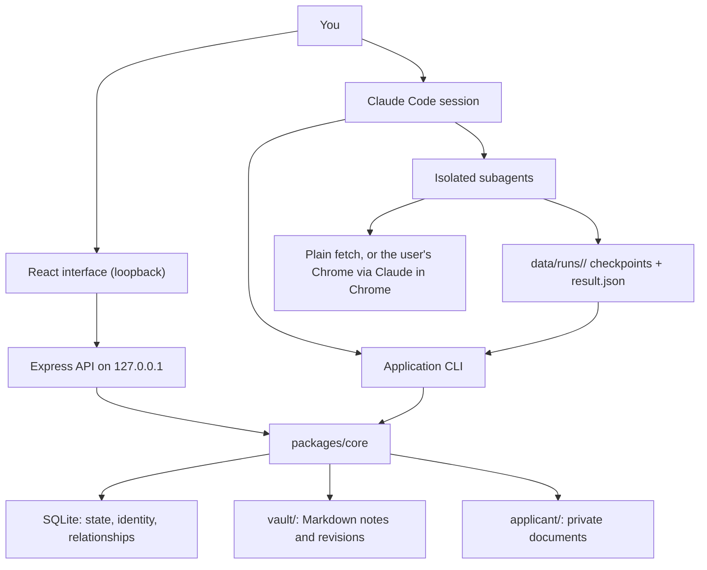
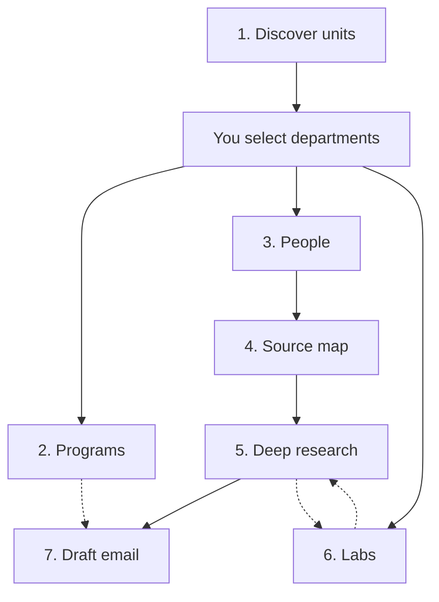

# Architecture

## The shape of the system

The interface and the CLI call the same core. There is no path into the vault or
the database that skips validation, versioning and the commit protocol.

## Execution model

Research runs in an interactive Claude Code session. The server has no model
credentials and cannot start one. This is deliberate, and the interface says so:
when nothing is executing it reads "Queued — start or resume Claude Code" rather
than implying that work is underway.

A running orchestrator claims a task, writes a compact packet for it, dispatches
one subagent, waits for that subagent to write a result file, validates it, and
commits. Then it looks for the next ready task.

## Packages

| Package | Responsibility |
| --- | --- |
| `packages/db` | SQLite adapter (better-sqlite3, falling back to `node:sqlite`), migrations, transactions with bounded busy retries, consistent backup |
| `packages/core` | Everything domain: identity, scope, tasks, the commit protocol, notes, outreach, timezones, readiness, backup |
| `packages/cli` | Deterministic commands for Claude and for you. No HTTP needed |
| `apps/server` | Express API bound to loopback, with host, origin and session checks |
| `apps/web` | React interface: fourteen screens over the same core operations |

## The seven jobs

Each job has an atomic unit, a minimum input, and a completion rule.

| Job | Unit | Needs | Produces |
| --- | --- | --- | --- |
| 1 discover_university | One university | A name to resolve | Unit hierarchy, one note per unit, a selection request |
| 2 research_programs | One included unit | A confirmed selection | Program notes with every category, evidence, conflicts |
| 3 discover_people | One included unit | A confirmed selection | People with roles and a coverage ledger |
| 4 map_person_sources | One person | Identity plus an affiliation | A classified source map |
| 5 research_person | One person | That person's source map | The deep profile and publication notes |
| 6 research_lab | One lab | A lab record or URL | Lab note, membership, recruitment notices |
| 7 draft_outreach | One person, purpose, program, campaign | Verified readiness | An email package for manual sending |

Plus `verify_person`, a targeted verifier that re-checks critical claims without
repeating the investigation.

### Dependencies are per record

Solid arrows are hard prerequisites for that record. Dotted arrows are
enrichment: a lab and a person can each inform the other without either waiting.
A program becomes a hard prerequisite for an email only when the message
actually relies on its facts.

## Task identity

A task is identified by job kind, target, scope version, relevant input
revisions, parameters and schema version. Two requests that agree on all of
those are the same task, so invoking a skill twice does not create a second unit
of work. Changing the email style invalidates affected drafts without touching
department discovery; changing the department selection affects only scoped
tasks.

## Isolation

Each candidate gets a fresh subagent with a packet containing only that person's
material. Workers write to their own run directory and nowhere else. Shared state
changes go through the core, which validates the result schema, the live scope
version and the fencing token before anything is installed.

## Stack

| Layer | Choice | Note |
| --- | --- | --- |
| Runtime | Node.js ≥ 24 | Verified on 26.8.1 |
| Language | TypeScript 5.9, ESM, NodeNext | Project references across packages |
| Database | SQLite via a small adapter | better-sqlite3 first, `node:sqlite` fallback |
| API | Express 5, Zod on every mutation | Loopback only |
| Interface | React 19, Vite 8, React Router 7 | Markdown sanitised with DOMPurify |
| Time | Temporal | Runtime's when present, `temporal-polyfill` otherwise |
| Notes | UTF-8 Markdown, typed YAML frontmatter | Real relative links, content hashes |
| Tests | `node:test` plus Playwright | Fictional fixtures only |

## Portability

Everything runs through Node's filesystem and process APIs and npm scripts. No
Bash, cron, systemd, Docker or database server. Paths are stored in posix form
and converted on use, filenames are checked against Windows reserved names and
characters, and link resolution is checked case-insensitively.

## Known limitations

- **The audit log only grows.** `audit_events` is append-only by design;
  corrections are appended, never rewritten. The change feed (`event_log`) is
  pruned after `events.retentionDays`, the audit log never is.
- **One browser.** Retrieval through Claude in Chrome uses the user's single
  browser, so browser-requiring assignments run serially. Nothing in the system
  crawls; there is no per-host scheduler beyond the delay workers observe
  between requests.
- **Leases recover work, they do not make it exactly-once.** After a lease
  expires two owners may research the same person; only one result commits and
  committing twice changes nothing.
- **Reconcile walks the vault.** Every run lists every note; unchanged notes
  are skipped by size and mtime, `reconcile --full` re-hashes them all. Very
  large vaults make startup noticeably slower.
- **Extraction is a person or Claude reading.** There is no PDF extractor.
  Document text enters through `/import-document` or by pasting it, with the
  method recorded, and stays unverified until a person checks it.
- **Nothing sends, nothing schedules, nothing runs unattended.** By design:
  see README.
