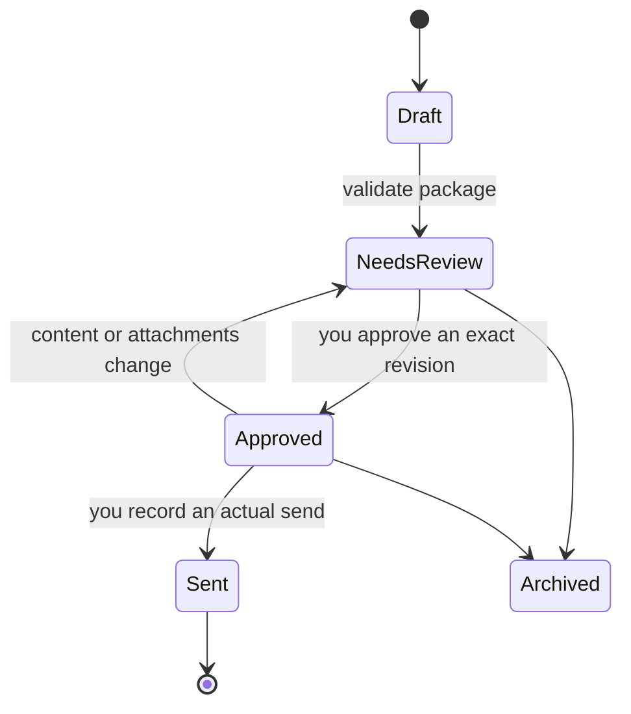

# Workflow engine

## Task states

| State | Meaning |
| --- | --- |
| `pending` | Ready to claim, or waiting only on concurrency |
| `blocked` | A prerequisite is not met. `blocked_reason` says which |
| `running` | Claimed, with a live lease and a fencing token |
| `partial` | Interrupted or budget-limited. Checkpoints are intact; it resumes |
| `complete` | Artifacts committed and validated |
| `retryable_failed` | Transient failure with a saved `next_attempt_at` |
| `failed` | Not retryable, or attempts exhausted |
| `cancelled` | Superseded by a scope change, or cancelled by you |
| `stale` | It ran against a scope version that is no longer current |

Readiness is derived from live prerequisites, not from a stored flag. A completed
artifact can later become stale without being erased.

## Blockers, per job

| Job | Blocked when |
| --- | --- |
| Any scoped job | No confirmed selection, or the target is not included, or the task's scope version is superseded |
| `map_person_sources` | The person has no recorded affiliation |
| `research_person` | No source map exists for that person |
| `verify_person` | Job 5 has not produced anything to verify |
| `research_lab` | No lab record exists for the target |
| `draft_outreach` | Research incomplete, recipient missing or unverified, contact conflict, applicant profile unapproved, or program facts the message uses are stale |
| Any | A retry cooldown has not elapsed |

`npm run research -- tasks list --state blocked --json` gives the exact reason
for each blocked task.

## Claiming

Claiming happens in one short transaction that:

1. reclaims any lease that has expired (those tasks become `partial`);
2. picks the highest-priority ready task matching the filter;
3. checks concurrency — total workers, and distinct person targets against
   `concurrency.candidates`;
4. increments the task's fencing token;
5. records the owner and a renewable lease;
6. creates `data/runs/<run-id>/` with `checkpoints/` and `staged/`.

Renew a long-running lease with `tasks renew`. Renewals are capped by
`leases.maxRenewals`; after that the task must be completed, failed or left to
expire and be reclaimed.

## Fencing

Every claim bumps a monotonic token. A commit must present the token that is
currently stored; an older owner's late result is rejected with
`fencing_rejected`, even if it arrives with perfectly good research in it.

Lease expiry is a recovery aid, not a promise that work ran exactly once. Two
owners may end up researching the same person after a lease expires. What is
guaranteed is that only one result commits, and that committing twice changes
nothing the second time.

## Checkpoints

```bash
npm run research -- tasks checkpoint --task <id> --owner <owner> --token <n> \
  --kind source|section|paper --label "what finished"
```

Checkpoints belong to the run that wrote them and survive it. A later run reads
them from its context packet and continues rather than restarting. Job 5
checkpoints after each source, each profile section and each paper.

## Retries

Transient failures (`transient`, `rate_limited`) get bounded exponential backoff
with jitter, capped at `retry.maxDelayMs`, saved as `next_attempt_at`. Claude
does not sit in a wait loop; the task simply is not ready until then. Pass
`--retry-after` to honour a server's Retry-After.

Other categories — `access_denied`, `unavailable_evidence`, `invalid_input`,
`conflict` — fail without a retry, because retrying them changes nothing.

Send-plan times never get jitter. They are exactly what you chose.

## Scope changes

Confirming a new selection version:

- keeps every note already written, untouched;
- cancels queued and blocked tasks that referenced the old version, with the
  reason recorded;
- re-queues targets that are still in scope, at the new version;
- marks tasks that are currently running as `stale` — their results will be
  refused at commit time by the scope check.

## Retrieval

Workers read the web in a fixed order, and record how each page was read.
The fetch and browser tools are deferred inside a subagent; a worker loads them
once with `ToolSearch` and checks the browser connection before its first
fetch.

1. A plain fetch, with `fetching.perHostDelayMs` between requests to the same
   host. A host that answers `rate_limited` is left alone for the rest of the
   run.
2. The user's own Chrome browser, through the Claude in Chrome tools, for hosts
   in `fetching.browserHosts` (Google Scholar by default) and for pages that
   come back as a JavaScript shell, a consent interstitial or a challenge page.
   One tab, read, close.
3. When no browser is connected, the source is recorded as `needs_browser` and
   left retryable. `/research-status` reports the count;
   `/map-person --retry-blocked` re-runs the affected Job 4 tasks once the
   extension is running.

Every source observation carries `fetch_method` (`web_fetch`, `browser`,
`web_search`, `manual`, `none`) next to its `access_status`, so a later run
can tell a plain-fetch block from something a browser also could not read.

The browser never logs in, never solves or waits out a CAPTCHA, never accepts
consent beyond the most restrictive option, never clicks a control that changes
state, and never follows a link because a page said to. It is one shared
resource, so browser-requiring assignments run one at a time and
`concurrency.candidates` stays at 1 while `fetching.browserAllowed` is on.
`config/worker-rules.md` is the version workers follow.

## Importing documents

There is no PDF extractor in the system. A document is imported into the
private store (`documents import`), and its text enters the workspace one of
two ways:

- `/import-document`: Claude reads the file with its Read tool, page by page,
  and records the verbatim text with `documents extract --text-file … --method
  claude_read --pages <n>`, then proposes facts with page references.
- The Applicant screen: paste text yourself, recorded with `method:
  manual_paste`.

Either way the extraction row names the method, the page count and the date,
the document version stays `unreviewed`, and every proposed fact stays
`unverified` until you verify it. Plain text and Markdown files are read
directly. Nothing is inferred from a document: no grade conversion, no date
deduced from a transcript's last term.

## Discovery expansion

People and laboratories discovered as a by-product of another job are always
persisted, given a navigable stub note, and added to the discovery queue with
their role and source. Only the *follow-up research* is capped, by
`research.expansionBudgetPerRun`. Nothing is dropped to stay under a budget.

## Configuration

`config/research.json`, with `config/local.json` overlaid on top if present
(git-ignored, for machine-specific settings):

```json
{
  "degreeScope":  { "primary": ["MASc", "MMath"], "related": ["MSc","MEng"], "allowRelated": false },
  "concurrency":  { "candidates": 1, "totalWorkers": 4 },
  "research":     { "publicationInventory": "all_in_scope", "paperSummaryMode": "all_accessible",
                    "expansionBudgetPerRun": 5, "requireVerifier": true },
  "retry":        { "maxAttempts": 3, "baseDelayMs": 2000, "maxDelayMs": 900000, "jitterRatio": 0.25 },
  "freshness":    { "contactDays": 30, "programFactsDays": 60, "profileDays": 120,
                    "publicationDays": 3650, "sourceObservationDays": 14 },
  "leases":       { "defaultSeconds": 1800, "maxRenewals": 48 },
  "fetching":     { "browserAllowed": true, "browserHosts": ["scholar.google.com"],
                    "perHostDelayMs": 2000, "maxBrowserPagesPerRun": 40 },
  "events":       { "retentionDays": 30 },
  "timing":       { "displayZone": "auto", "suggestStartHour": 9, "suggestEndHour": 11 }
}
```

## Freshness

Claims carry a freshness class. `critical` claims — the recipient address,
contact instructions, application requirements, funding statements — are
re-checked before an email can be approved. Paper summaries are not regenerated
while the publication itself has not changed.

## Email states



Approval binds the recipient, subject, exact body and attachment versions
through a content fingerprint. Changing a planned time changes the send plan,
not the approved content. Passing a planned time changes a calculated view and
nothing else.
